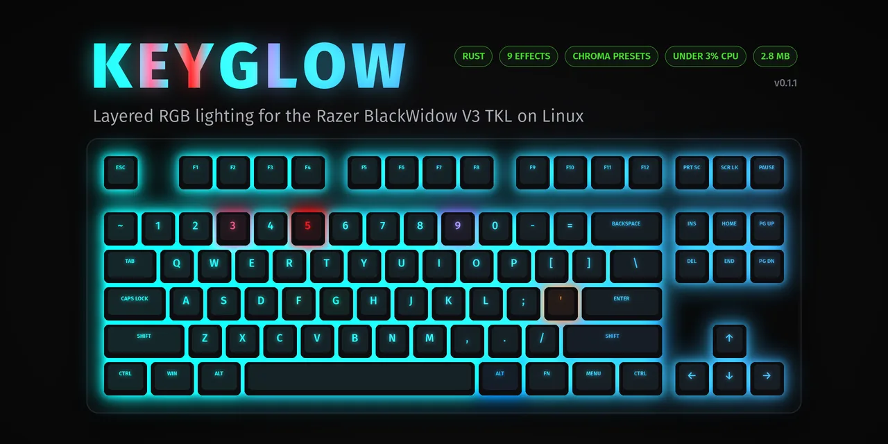
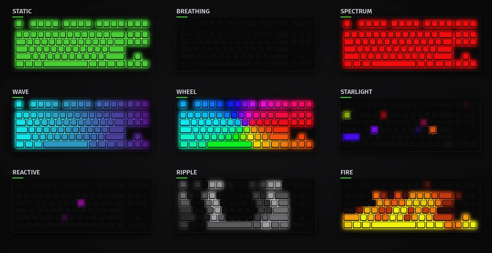
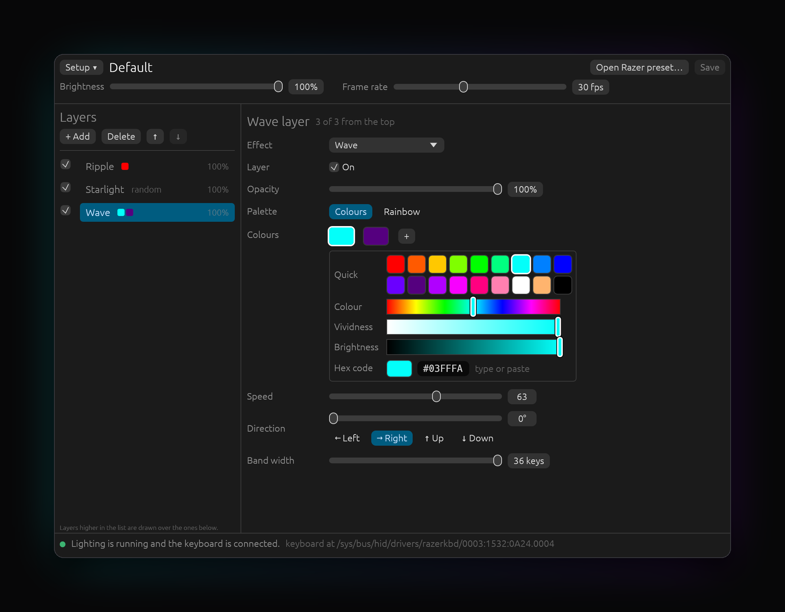

  

  
  
  
  
  

# Keyglow

Layered keyboard lighting for the Razer BlackWidow V3 Tenkeyless on Linux. It works the way Razer Chroma Studio does on Windows: you stack effects, such as a colour wave, twinkling keys and a ripple from every key you press, and they all play at once.

Two programs make it up:

- `keyglowd` is a tiny background program that draws the lighting. It starts at login and needs no window.
- `keyglow` is the settings window. Open it when you want to change something, then close it. The lighting keeps running.

Only this keyboard model is supported and tested. It was built and tested on Pop!_OS 24.04 with COSMIC on Wayland.

## Effects

  

Every keyboard above is drawn from real Keyglow frames, made by the same code that lights the keyboard. Reactive and Ripple are answering simulated typing.

## What you need

- The OpenRazer kernel driver (`razerkbd`) installed. The OpenRazer daemon can stay running. When it dims the keyboard for the screen saver, `keyglowd` pauses until the brightness comes back.
- Your user in the `plugdev` group. No root is needed to run or install Keyglow.
- Read access to the keyboard's input device, so `keyglowd` can see key presses for Ripple and Reactive. The logged-in user normally has it through the desktop's access list for the device, or through the `input` or `plugdev` group. Without it the lighting still runs, but nothing reacts to keys.
- Linux 6.12 or newer, so the lighting keeps up while the computer is busy. Older kernels work too, but under load the frames and key presses can lag.
- Rust, only if you build it yourself (`~/.cargo/bin/cargo` or `cargo` on your PATH).
- OpenRGB, or anything else that lights the keyboard, turned off for this keyboard. Two programs drawing at once will flicker against each other.

## Install

### From a release

Download `keyglow-v0.1.1-x86_64-linux.tar.gz` from the [releases page](../../releases), then:

    tar xf keyglow-v0.1.1-x86_64-linux.tar.gz
    cd keyglow-v0.1.1-x86_64-linux
    ./install.sh --enable

The programs in the download are already built, so you don't need Rust. They were built on Pop!_OS 24.04 and need glibc 2.39 or newer (Ubuntu 24.04 and later have it). On an older system, build from source instead.

### From source

From the project folder:

    ./install.sh --enable

This first builds a release version at low priority with at most 4 build jobs (set `CARGO_BUILD_JOBS` to change that).

Either way, `install.sh` copies `keyglowd` and `keyglow` to `~/.local/bin`, installs a login service and a launcher entry, and starts the lighting. Leave out `--enable` to install without starting anything. Running it again later updates an existing install.

## Using the window

Open Keyglow from the app launcher, or run `keyglow`.

  

- The left side lists your layers, top layer first. Each has an on/off switch. Use the buttons to add a layer, delete one, or move it up or down.
- The right side shows the chosen layer's settings: its colours, sliders for speed, size and density, and direction where it applies. Click a colour to change it in the picker underneath. Pick one of the quick colours, drag the colour, vividness and brightness strips, or type or paste a hex code. The keyboard changes while you drag, and effects that are already running carry on rather than starting over.
- The top bar has the setup name, a setup menu (switch, save, save as, rename, delete), Open Razer preset, overall brightness and frame rate.
- The status line shows whether `keyglowd` is running and whether it can see the keyboard.

Effects: Static, Breathing, Spectrum, Wave, Wheel, Starlight, Reactive, Ripple, Fire. You can use any number of layers, and the same effect more than once. Every layer covers the whole keyboard. Starlight, Reactive and Ripple only colour the keys they are lighting, so the layers below show through.

The default setup is a cyan to purple wave, random-colour twinkles and a white ripple on every key press.

### Saved setups

Changes reach the keyboard at once, but a saved setup only changes when you press Save. The window marks a setup as unsaved when it differs from the saved file, and asks before you switch away from unsaved changes.

### Razer presets

Choose Open Razer preset and pick a `.ChromaEffects` file. Its layers become Keyglow layers. Some things cannot carry over, and the window tells you what happened:

- Regions and per-device key lists are ignored. Every layer covers the whole keyboard.
- Only Ripple and Reactive respond to key presses. A Static or Breathing layer that starts on a key press becomes a Reactive layer in the same colour. Any other effect set to start on a key press is skipped.
- Effects Keyglow does not have are skipped.

## How it starts

The install puts a systemd user service at `~/.config/systemd/user/keyglowd.service`. It starts `keyglowd` at login, restarts it if it fails (a crash or an error exit, not when you stop it yourself), and runs it at low priority with a CPU and memory limit. Handy commands:

    systemctl --user status keyglowd
    systemctl --user restart keyglowd
    journalctl --user -u keyglowd

`keyglowd` copes with the keyboard being unplugged and plugged back in, and with sleep and wake. While the keyboard is missing it looks for it again every couple of seconds.

## Cost

While something is animating at 30 frames a second, `keyglowd` uses about 1 to 3% of one core, almost all of it the keyboard driver's USB transfers, and under 3 MB of memory. When nothing is moving it draws nothing and sleeps, except that it resends the last frame every 5 seconds, so another program can't take the keyboard over for long. The window uses nothing when closed and almost nothing when idle.

It also asks the kernel for a short time slice, so it gets a CPU soon after it wakes even while a game or a build keeps every core busy. That changes when it runs, not how much CPU it takes.

## Files

- `~/.config/keyglow/active.json`: the setup on the keyboard now. The window writes it and `keyglowd` watches it.
- `~/.config/keyglow/setups/<name>.json`: your saved setups. They are plain JSON.
- `$XDG_RUNTIME_DIR/keyglow/status.json`: a small status file `keyglowd` writes so the window can show its state.
- `~/.local/bin/keyglowd`, `~/.local/bin/keyglow`, `~/.config/systemd/user/keyglowd.service`, `~/.local/share/applications/keyglow.desktop`: what the installer puts down.

For testing, `keyglowd` accepts `--config-dir`, `--sysfs-dir`, `--input-dir` and `--status-file`. The defaults are the real paths.

## Troubleshooting

- The window says the keyboard is not found: check the OpenRazer driver is loaded and that your user is in `plugdev` (`id`). Log out and in again after joining the group.
- The lighting flickers: something else is lighting the keyboard. Stop OpenRGB or other lighting tools for it.
- The keyboard goes dark when the screen locks: that is OpenRazer dimming it for the screen saver. It comes back on unlock.
- A ripple starts from the wrong key: key positions come from OpenRazer's key table, and the fix is one line in `crates/keyglow-core/src/keymap.rs`.
- Anything else: `journalctl --user -u keyglowd`.

## Privacy

`keyglowd` reads key presses from the keyboard's own input device only to learn which key to ripple from. It never logs, prints or stores them, forgets each press once its effect has faded, and does not grab the keyboard, so typing works everywhere as usual.

## Uninstall

    ./install.sh --uninstall

This stops and disables the service and removes the files the installer put down. Your settings in `~/.config/keyglow` are kept. Delete that folder yourself if you want them gone.

## License

MIT. See [LICENSE](LICENSE).
